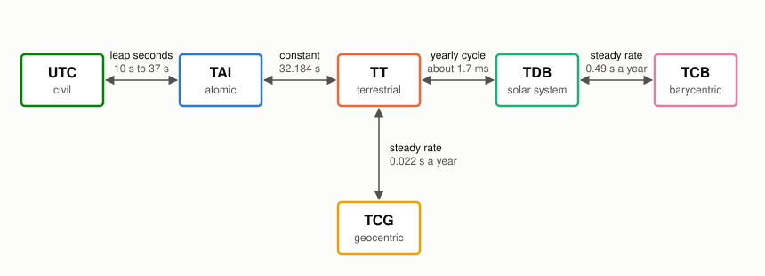

```@meta
CurrentModule = AstroEpochs
```

# AstroEpochs

The AstroEpochs package provides `Time`, an astronomical epoch held as a two-part Julian date in one of six time scales: TAI, TT, UTC, TDB, TCB and TCG. It converts between the scales, reads and writes Julian dates, Modified Julian Dates and calendar timestamps, and keeps the IERS leap-second list current. Packages such as AstroFrames, AstroProp and AstroSolve use it for every time they handle.

AstroEpochs uses the algorithms of Astropy's `Time`, which come from ERFA, and is tested against Astropy.

## Quick Start

The example below creates a time from a UTC timestamp, converts it to other scales, and moves it forward by 60 elapsed seconds.

```julia
using AstroEpochs

# Create from a UTC timestamp
t = Time("2017-01-01T00:00:00", UTC(), ISOT())

# Convert to other scales
t.tai.isot    # "2017-01-01T00:00:37.000"
t.tt.isot     # "2017-01-01T00:01:09.184"

# Advance by 60 elapsed seconds, then return to UTC
later = (t.tai + 60 / 86400).utc
later.isot    # "2017-01-01T00:01:00.000"
```

A time displays its value, scale and format at the REPL:

```text
julia> Time("2017-01-01T00:00:00", UTC(), ISOT())
AstroEpochs.Time
  value  = 2017-01-01T00:00:00.000
  scale  = UTC()
  format = ISOT()
```

Inside something else, such as a vector or a string, it prints on one line, as `Time("2017-01-01T00:00:00.000", UTC(), ISOT())`.

`Dates` exports `Time` and `UTC` too. If a script uses both packages, import what you need from `Dates`, as in `using Dates: DateTime`, or write `AstroEpochs.Time` and `AstroEpochs.UTC`. The two packages exchange times as strings:

```julia
using AstroEpochs
using Dates: DateTime

t = Time(string(DateTime(2024, 1, 1, 12)), UTC(), ISOT())
DateTime(t.isot)    # 2024-01-01T12:00:00
```

## Creating a Time

The scale you pass says how to read the input. It does not convert anything, so give the scale your source states. The same text read on two scales gives two different instants, and to convert a time you already hold, use a property such as `t.tt`.

```julia
using AstroEpochs

# One text, read on two scales
text = "2017-01-01T00:00:00"
Time(text, UTC(), ISOT()).tt.isot    # "2017-01-01T00:01:09.184"
Time(text, TT(), ISOT()).tt.isot     # "2017-01-01T00:00:00.000"
```

A format sets how a time is written. It never changes the date.

| Format | Input | Example |
|:-------|:------|:--------|
| `JD()` | Julian date: days since noon on January 1, 4713 BCE in the Julian calendar | `Time(2451545.0, TT(), JD())` |
| `MJD()` | Modified Julian date: the Julian date less 2400000.5 | `Time(51544.5, TT(), MJD())` |
| `ISOT()` | Timestamp, `YYYY-MM-DDTHH:MM:SS` with optional decimal seconds and a four-digit year | `Time("2000-01-01T12:00:00", TT(), ISOT())` |

A timestamp has no time zone suffix, since the scale says what clock it is on, and the time of day is required. A timestamp string does not record its scale, so keep the scale with it when you write times to a file.

```julia
using AstroEpochs

# A date in two parts, summed, which holds more precision than one number
Time(2451545.0, 0.25, TT(), JD()).isot               # "2000-01-01T18:00:00.000"

# Calendar fields, with the format to display in
Time(2024, 3, 1, 12, 30, 15.25, UTC(), ISOT()).isot  # "2024-03-01T12:30:15.250"
```

## Time Scales

AstroEpochs has six time scales.

| Scale | Description |
|:------|:------------|
| `TAI()` | International Atomic Time, the uniform scale kept by atomic clocks |
| `TT()` | Terrestrial Time, TAI plus 32.184 s, the scale of dynamics around the Earth |
| `TDB()` | Barycentric Dynamical Time, the scale of solar-system ephemerides. It differs from TT by a yearly cycle of about 1.7 ms |
| `UTC()` | Coordinated Universal Time, the civil scale, kept near the Earth's rotation by leap seconds |
| `TCB()` | Barycentric Coordinate Time, which gains about 0.49 s a year on TDB |
| `TCG()` | Geocentric Coordinate Time, which gains about 0.022 s a year on TT |

The figure shows every scale against TAI. TT sits a constant 32.184 s away. TDB follows TT with its yearly cycle, and TCB adds the same cycle to a steady drift. TCG drifts slowly away from TT. UTC steps at each leap second, and the figure stops it at 2026, since later leap seconds are unknown. The periodic term of TCB is magnified by 100 so it can be seen. TDB's, also magnified, still lies within the width of the TT line.


*The numbers are from AstroEpochs. The form of the figure follows Figure 1 of Seidelmann and Fukushima (1992).*

The scales connect as a graph, and a conversion walks it. Going from TCB to UTC passes through TDB, TT and TAI in turn, so you ask for the scale you want and the route is taken care of.



Use UTC for the times you read in and write out. It is a civil scale built for clocks, not one to do dynamics in, so Epicycle's dynamics work in TT and TDB. UTC is defined here from 1972: before that date AstroEpochs uses TAI − UTC = 0 and warns, where the historical offset was up to about 10 s.

A property converts to a scale you name in the script. `Time(t, scale)` does the same when the scale is held in a variable. A conversion keeps the format.

```julia
using AstroEpochs

t = Time(2451545.0, TT(), JD())

# Convert to a scale by name
t.tdb.scale                  # TDB()

# Convert to a scale held in a variable
scale = TAI()
Time(t, scale).scale         # TAI()

# Read the offsets between scales, in seconds
tdb_minus_tt(t)              # -9.930719894379447e-5
tai_minus_utc(t)             # 32.0
```

`t.tdb` is TDB at the geocentre, since a `Time` carries no location. For an observer on the Earth, `tdb_minus_tt(t, position)` adds the observer's terms, up to about 2 µs. `position` is the observer's position from the Earth's centre in km, in Earth-fixed axes.

AstroEpochs does not provide UT1, GPS time or time zones. UT1 for Earth rotation comes from the Earth orientation data in AstroUniverse.

## Leap Seconds

UTC differs from TAI by a whole number of seconds, TAI − UTC, which changes when the IERS adds a leap second. The IERS announces each one in Bulletin C, about six months ahead, and TAI − UTC has been 37 s since 2017-01-01.

AstroEpochs reads TAI − UTC from `leap-seconds.list`, the IERS list as IANA publishes it at <https://data.iana.org/time-zones/tzdb/leap-seconds.list>. Each data line gives the date of a change, in seconds since 1900-01-01, and the value of TAI − UTC from that date. The line that begins `#@` gives the date the list expires, which the IERS extends each time it confirms that no leap second is coming. The change takes effect at 0h UTC on the date given.

The file is stored in AstroEpochs' Scratch space:

```text
<depot>/scratchspaces/241dcde3-d7a4-450d-948f-15f2ea2ba1fa/leap_seconds/leap-seconds.list
```

where `<depot>` is the first entry of `DEPOT_PATH`, usually `~/.julia`. AstroEpochs downloads the list the first time a session needs TAI − UTC, which includes reading or writing a timestamp in UTC, when no stored copy exists or the stored copy has passed its expiry date. That first use waits at most 10 s for the download. A session checks once and keeps that table until it ends.

| Situation | What AstroEpochs uses | What it says |
|:----------|:----------------------|:-------------|
| A current stored copy | The stored copy | Nothing |
| An expired copy, and no network | The expired copy | A warning |
| No copy, and no network | The built-in table, which ends at the 2017-01-01 leap second | A warning |
| A depot that cannot be written | The list, downloaded for this session only | A warning |
| A damaged list | The list is refused, and the row above that applies is used | The warning of that row |

A list must match the hash on its last line and hold every change through 2017. That catches a damaged file. It does not establish where the file came from.

A UTC date after the list's last entry uses its last value, since future leap seconds are unknown. More than five years past the list's expiry, this warns once per session.

```julia
using AstroEpochs

# Asking for TAI − UTC loads the list, downloading it if none is stored
tai_minus_utc(Time("2024-01-01T00:00:00", UTC(), ISOT()))    # 37.0

# Where the list is stored, and its contents, if it could be stored
path = joinpath(DEPOT_PATH[1], "scratchspaces", "241dcde3-d7a4-450d-948f-15f2ea2ba1fa",
                "leap_seconds", "leap-seconds.list")
isfile(path) && print(read(path, String))
```

`refresh_leap_seconds!()` downloads the list now, which picks up a newly announced leap second in a running session or before the stored copy expires. It replaces the stored copy and the table in use, and returns that table. If the download fails or the list is refused, it throws, and the table in use stays as it was.

```@raw html
<!-- doc-fragment -->
```
```julia
using AstroEpochs

# Download the list now
refresh_leap_seconds!()    # LeapSecondTable: TAI − UTC = 37 s from 2017-01-01, list expires 2027-06-28
```

## Formats and Precision

The format properties give a time as a number or a string. `Time(t, format)` changes how a time displays and holds the date exactly as it was, which building a new time from `t.mjd` or `t.isot` does not do, since each of those is rounded.

```julia
using AstroEpochs

t = Time(2451545.0, 0.25, TT(), JD())

# Read the date as a number or a string
t.jd                      # 2.45154525e6
t.mjd                     # 51544.75
t.isot                    # "2000-01-01T18:00:00.000"

# Write a string with six decimal places of seconds
isot(t; digits = 6)       # "2000-01-01T18:00:00.000000"

# Change how the time displays
Time(t, MJD()).format     # MJD()
```

`isot` writes from 0 to 12 decimal places. A `Time` resolves about 10 ps, so more than 11 carry nothing.

A `Time` holds a date in two parts, a whole day and a fraction, so two times can differ by far less than a nanosecond at any date and the difference still comes back. The precision is only as good as what you pass in and read out. One number at the size of a Julian date resolves about 40 µs, and a Modified Julian Date about 0.6 µs. To keep everything, build a time from two parts and save `t.jd1` and `t.jd2`, not `t.jd`, along with the scale. Those figures are for `Float64`.

```julia
using AstroEpochs

a = Time(2451545.0, 0.0, TT(), JD())
b = a + 1e-12

# The difference survives, in seconds
(b - a) * 86400    # 8.64e-8

# One number loses it
b.jd == a.jd       # true
```

A whole-number date is promoted to floating point. `Time{T}(t)` changes the numeric type of a time you hold. A scale conversion promotes to at least `Float64`, so a `Time{Float32}` comes back as `Time{Float64}`, and `BigFloat` and derivative types carry through.

## Arithmetic and Comparison

Adding a number moves a time by that many days, and subtracting two times in the same scale gives the days between them. The format of each plays no part.

```julia
using AstroEpochs

t = Time(2451545.0, TT(), JD())

# Move forward a quarter of a day
later = t + 0.25
later.isot    # "2000-01-01T18:00:00.000"

# Find the days between two times
later - t     # 0.25
```

Arithmetic happens in the scale you are in. UTC has leap seconds, so a difference between two UTC times is not elapsed time. For elapsed time, convert first:

```julia
using AstroEpochs

a = Time("2000-01-01T00:00:00", UTC(), ISOT())
b = Time("2020-01-01T00:00:00", UTC(), ISOT())

# The calendar seconds between the labels
(b - a) * 86400            # 6.31152e8

# The seconds that elapsed
(b.tai - a.tai) * 86400    # 6.31152005e8
```

On a day with a leap second, UTC runs 86,401 seconds to the day, and a UTC date's fraction stretches over all of them. Results that touch that day can differ from clock time by up to a second, and a number means the fraction, not the clock.

```julia
using AstroEpochs

# Half of the 86,401 seconds, not noon
Time(57753.5, UTC(), MJD()).isot    # "2016-12-31T12:00:00.500"
```

Times compare within one scale.

| Operation | Different scales | Meaning |
|:----------|:-----------------|:--------|
| `a == b` | `false` | The same date, to the last bit. The format plays no part, and `hash` agrees |
| `isapprox(a, b; atol)`, `a ≈ b` | Throws | Within `atol` seconds, a nanosecond by default |
| `a < b`, `sort`, `minimum`, `maximum` | Throws | The order of the instants |
| `a - b` | Throws | Days between the dates |

Two times written separately rarely satisfy `==`, even when they mean the same instant, because each number is rounded on its own. `isapprox` is the comparison for them.

```julia
using AstroEpochs

a = Time(2460000.123, TT(), JD())
b = Time(59999.623, TT(), MJD())

# They differ by 12 µs
a == b                         # false
isapprox(a, b; atol = 1e-3)    # true
```

Broadcasting adds to one time, which gives a grid of times in one line:

```julia
using AstroEpochs

t = Time("2024-01-01T00:00:00", TT(), ISOT())

# A quarter-day grid
grid = t .+ (0:0.25:1)
[g.isot for g in grid][2]      # "2024-01-01T06:00:00.000"
t < grid[end]                  # true
```

## Conventions

- An interval is in days. `isapprox`, `tai_minus_utc` and `tdb_minus_tt` work in seconds.
- An observer's position is in km, in Earth-fixed axes.
- Calendar dates are proleptic Gregorian.
- A format sets how a time displays and never changes the date.
- A time with no finite date passes through arithmetic and conversion, prints, and has no calendar date to write.

## Differentiability

Construction, day arithmetic and scale conversions are differentiable with ForwardDiff, as the test suite checks against a central difference. The date's whole day is a rounded number, so the derivative is carried in the fraction, and calendar dates, timestamps and leap-second steps have no derivative.

```julia
using AstroEpochs, ForwardDiff

t = Time(2451545.0, TT(), JD())

# The rate of TAI seconds against TT seconds
ForwardDiff.derivative(s -> ((t + s / 86400).tai - t.tai) * 86400, 0.0)    # 1.0
```

## Validation

The test suite compares AstroEpochs with stored results from Astropy 8.0.1 at 1793 epochs across every scale, to 20 ps in the date and exactly in the millisecond timestamp, except for UTC before 1972, which differs by up to about 10 s. Separate runs with new random epochs matched every part of the date exactly.

The test suite compares TDB − TT with observer terms with pyerfa at 100 random dates and observers, to 1e-17 s. This is agreement with an implementation, not a measure of physical accuracy: ERFA documents the TDB series as agreeing with ephemeris-based TDB to a few nanoseconds over 1600 to 2200, which AstroEpochs has not checked against an ephemeris.

## Comparison with Other Packages

AstroTime.jl supports TAI, TT, TCG, TCB, TDB and UT1, and Tempo.jl supports TAI, TT, TDB, TCG, TCB, UTC and GPS, among others. Both carry the scale in the type of an epoch, so a conversion changes the type. AstroEpochs holds the scale as a value, so one `Time` type covers every scale, which Epicycle's propagation and optimization rely on, and it keeps the IERS leap-second list current itself.

## References

- Fairhead, L. and Bretagnon, P. (1990), An analytical formula for the time transformation TB−TT, Astronomy and Astrophysics 229, 240.
- IAU SOFA Board, Standards of Fundamental Astronomy; ERFA, Essential Routines for Fundamental Astronomy, <https://github.com/liberfa/erfa>.
- Astropy Collaboration, Astropy, <https://www.astropy.org>.
- Seidelmann, P. K. and Fukushima, T. (1992), Why new time scales?, Astronomy and Astrophysics 265, 833.

The algorithms ported from ERFA and Astropy, and the built-in leap-second table adapted from Tempo.jl, are credited in [`THIRD_PARTY_NOTICES.md`](https://github.com/GenAstro/Epicycle/blob/main/AstroEpochs/THIRD_PARTY_NOTICES.md).

## API Reference

```@docs
AstroEpochs
```

```@autodocs
Modules = [AstroEpochs]
Public  = true
Private = false
Order = [:type, :function, :macro, :constant]
```

These extend functions in Base, which do not belong to AstroEpochs' own list above.

```@docs
Base.getproperty(::Time, ::Symbol)
Base.isapprox(::Time, ::Time)
Base.:(==)(::Time, ::Time)
Base.:+(::Time, ::Real)
Base.:-(::Time, ::Time)
Base.:-(::Time, ::Real)
```

```@index
Pages = ["index.md"]
```
