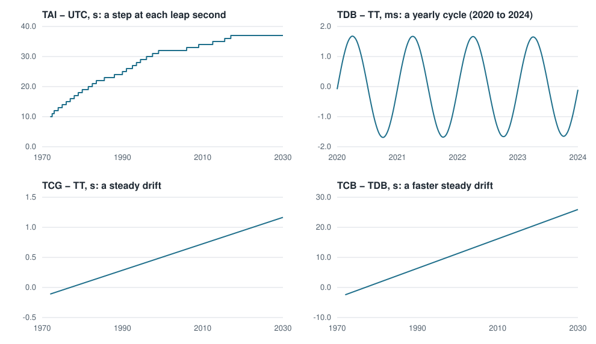

```@meta
CurrentModule = AstroEpochs
```

# AstroEpochs

The AstroEpochs module provides time system implementations for astronomical applications. AstroEpochs supports high-precision time representations using dual-float Julian Date storage, parameterized for differentiability, and conversions between time scales and formats.

**Key Features:**
- **High-precision storage** using dual Float64 values (`jd1`, `jd2`) to represent Julian Dates
- **Automatic scale conversion** via property access (e.g., `t.tt`, `t.utc`, `t.tdb`)
- **Multiple input formats** including Julian Date, Modified Julian Date, and ISO 8601 strings
- **Time arithmetic** supporting addition and subtraction of time intervals
- **One type across scales**, so a scale change does not change the type of a `Time`
- **Differentiability** using standard packages such as ForwardDiff and Zygote

## Acknowledgements

The API for AstroEpochs is inspired by Astropy.Time, and its algorithms are Astropy's: the scale transforms, TDB − TT, calendar and ISOT formatting are ported from ERFA, the library Astropy uses. AstroEpochs.jl is tested against Astropy.Time at 1793 epochs across every scale, and agrees to the last bit of the date except for UTC before 1972, which is a known gap. See `THIRD_PARTY_NOTICES.md`.

## Comparison with Other Julia Time-Keeping Libraries

Tempo.jl and AstroTime.jl also handle astronomical time in Julia. AstroTime.jl, from the JuliaAstro community, supports six time scales (TAI, TT, TCG, TCB, TDB and UT1) with a separate type for each scale, so a conversion changes the type. Tempo.jl supports UTC, TAI, TT, TDB, TCG and TCB with allocation-free conversions, and changes scale without changing the type. AstroEpochs also keeps one type across scales, which Epicycle's propagation and optimization rely on, but its conversions are not allocation-free: TT ↔ TDB evaluates ERFA's 787-term series, 2.5 to 6.5 µs a conversion depending on the epoch, and allocates a little. AstroEpochs follows the interface of Astropy's `Time` and uses its algorithms (ERFA), agreeing with it to the last bit of the date, and keeps the IERS leap-second list current itself. 

## Quick Start

```julia
using AstroEpochs

# Create from Julian Date
t1 = Time(2451545.0, TT(), JD())

# Create from Modified Julian Date  
t2 = Time(51544.5, UTC(), MJD())

# Create from ISO string
t3 = Time("2000-01-01T12:00:00.000", TAI(), ISOT())

# Access different representations
t1.jd        # Julian Date value
t1.mjd       # Modified Julian Date value  
t1.isot      # ISO 8601 string

# Convert between scales (creates new Time object)
t_utc = t1.utc
t_tdb = t1.tdb
```

Scale properties return new `Time` values. Format properties return a number
for `jd` and `mjd`, or a string for `isot`.

## Time Struct

The `Time` struct is the core type for representing astronomical epochs with high precision. It uses a split Julian Date representation to maintain numerical accuracy over long time spans and supports automatic conversions between different time scales and formats.

**Fields:**
- `jd1` — Whole number of days in the split Julian Date
- `jd2` — Fraction of a day in the split Julian Date, between -0.5 and 0.5
- `scale` — the time scale, as a tag: `TT()`, `TAI()`, `UTC()`, `TDB()`, `TCB()` or `TCG()`
- `format` — the time format, as a tag: `JD()`, `MJD()` or `ISOT()`

The complete Julian Date is `jd1 + jd2`. Every `Time` normalizes its date this way when it is built, so you can split a date any way you like when you pass it in. Passing a date in two parts keeps a small offset that one number at the size of a Julian Date cannot hold.

```julia
using AstroEpochs

t = Time(2451545.0, TT(), JD())

t.scale == TT()     # true
t.format == JD()    # true
```

## Time Scales

AstroEpochs supports various astronomical time scales.

| Scale | Description |
|:------|:------------|
| **TAI** | International Atomic Time - Uniform atomic time scale based on cesium atomic clocks |
| **TT** | Terrestrial Time - Theoretical uniform time scale for Earth-based observations (TT = TAI + 32.184s) |
| **TDB** | Barycentric Dynamical Time - Time scale for solar system dynamics, corrected for relativistic effects |
| **UTC** | Coordinated Universal Time - Civil time standard with leap seconds to maintain alignment with Earth rotation |
| **TCB** | Barycentric Coordinate Time - Coordinate time in the barycentric reference system |
| **TCG** | Geocentric Coordinate Time - Coordinate time in the geocentric reference system |

The figure shows every scale against TAI. TT sits a constant 32.184 s away. TDB follows TT with a yearly cycle of about 1.7 ms, and TCB adds the same cycle to a steady drift. TCG drifts slowly away from TT. UTC steps at each leap second. The periodic terms of TDB and TCB are magnified by 100 so they can be seen.



*The numbers are from AstroEpochs. The form of the figure follows Figure 1 of Seidelmann and Fukushima, "Why new time scales?", Astronomy and Astrophysics 265, 833 (1992).*

Use UTC for the times you read in and write out. It is a civil scale built for clocks, not one to do dynamics in, so Epicycle's models work in TT and TDB. UTC is defined from 1972 here: before that date AstroEpochs uses TAI − UTC = 0 and warns, where the historical offset was up to about 10 s.

## Time Formats

AstroEpochs supports multiple time formats for input and output:

| Format | Description | Example |
|:-------|:------------|:--------|
| **JD** | Julian Date - Days since January 1, 4713 BCE at noon | 2451545.0 |
| **JD (precision)** | Julian Date with split representation for high precision | jd1=2451545.0, jd2=0.378264 |
| **MJD** | Modified Julian Date - JD minus 2400000.5 | 51544.5 |
| **ISOT** | ISO 8601 timestamp string | "2000-01-01T12:00:00.000" |

## Usage Examples

The examples below illustrate how to create a time struct in various time scales.

```julia
using AstroEpochs

# Time using TAI
t_tai = Time(51545.0, TAI(), MJD())

# Time using TDB
t_tdb = Time(51545.0, TDB(), MJD())

# Time using UTC
t_utc = Time(51545.0, UTC(), MJD())

# Time using TCB
t_tcb = Time(51545.0, TCB(), MJD())

# Time using TCG
t_tcg = Time(51545.0, TCG(), MJD())
```

Converting between time scales creates a new Time object with the converted epoch:

```julia
using AstroEpochs

# Convert from TAI to TT
t_tai = Time(51545.0, TAI(), MJD())
t_tt = t_tai.tt

# Convert from UTC to TDB
t_utc = Time(51545.0, UTC(), MJD())
t_tdb = t_utc.tdb

# Chain conversions while preserving format
t_final = t_utc.tai.tt.tdb
```

When the scale is held in a variable, `Time(t, scale)` does the same conversion. This measures the time between two epochs in the scale of the first, whatever scale the second is in:

```julia
using AstroEpochs

a = Time(2451545.0, TT(), JD())
b = Time(2451545.5, TDB(), JD())

days_between = Time(b, a.scale) - a
```

`tai_minus_utc(t)` and `tdb_minus_tt(t)` give the offsets between scales at a time, in seconds. `tdb_minus_tt(t, position)` adds the terms for an observer at an Earth-fixed position in km.

```julia
using AstroEpochs

t = Time("2024-01-01T00:00:00", UTC(), ISOT())

tai_minus_utc(t)
tdb_minus_tt(t)
tdb_minus_tt(t, [-2353.6, -4641.3, 3677.1])
```

## Leap Seconds

UTC differs from TAI by a whole number of seconds, TAI − UTC, which changes when the IERS adds a
leap second. The IERS announces each one in Bulletin C, about six months ahead; TAI − UTC has
been 37 s since 2017-01-01.

AstroEpochs reads TAI − UTC from `leap-seconds.list`, the IERS list as IANA publishes it at
<https://data.iana.org/time-zones/tzdb/leap-seconds.list>. Each data line gives the date of a
change, in seconds since 1900-01-01, and the value of TAI − UTC from that date. The line that
begins `#@` gives the date the list expires, which the IERS extends each time it confirms that
no leap second is coming. The change takes effect at 0h UTC on the date given.

The file is stored in AstroEpochs' Scratch space:

```text
<depot>/scratchspaces/241dcde3-d7a4-450d-948f-15f2ea2ba1fa/leap_seconds/leap-seconds.list
```

where `<depot>` is the first entry of `DEPOT_PATH`, usually `~/.julia`. AstroEpochs downloads it
the first time a session converts to or from UTC and no stored copy exists, or when the stored
copy has passed its expiry date. A session checks once, when it first needs the list, and keeps
that table until it ends. `refresh_leap_seconds!()` downloads the list immediately.

Without a network connection, an expired copy is used with a warning. With no copy at all, the
built-in table is used, which ends at the 2017-01-01 leap second, also with a warning. A list is
checked against its own hash and against the built-in table before it is used or stored, so a
damaged file is refused. If the depot cannot be written, the list is downloaded each session.
A UTC date before 1972-01-01 has no leap-second value; AstroEpochs uses 0 and warns.

```@raw html
<!-- doc-fragment -->
```
```julia
using AstroEpochs

# Where the list is stored, and its contents
path = joinpath(DEPOT_PATH[1], "scratchspaces", "241dcde3-d7a4-450d-948f-15f2ea2ba1fa",
                "leap_seconds", "leap-seconds.list")
isfile(path)                # true once a UTC conversion has run
print(read(path, String))

# Download the list now, rather than when the stored copy expires
refresh_leap_seconds!()
```

## Format Conversion

Lowercase format properties expose the same epoch in another representation.

```julia
t = Time(2451545.25, UTC(), JD())

jd = t.jd
mjd = t.mjd
timestamp = t.isot
```

`Time(t, format)` changes how a time displays. The date is held exactly as it was, which building a new time from `t.mjd` or `t.isot` does not do, since each of those is rounded.

```julia
t_mjd = Time(t, MJD())
```

`isot(t; digits)` writes the string with as many decimal places of seconds as you ask for. `t.isot` writes three.

```julia
isot(t; digits = 6)
```

A time can also be built from calendar fields:

```julia
t = Time(2024, 3, 1, 12, 30, 15.25, UTC(), ISOT())
```

## Precision And Arithmetic

`Time` stores a Julian Date as `jd1 + jd2`, which keeps a difference well below a
nanosecond at any date.

Arithmetic uses days. Adding a real number advances an epoch by that many days,
and subtracting two epochs in the same scale returns their separation in days.
Their formats may differ.

Arithmetic happens in the scale you are in. UTC has leap seconds, so a difference between two UTC
times is not elapsed time; for elapsed time, convert first:

```julia
a = Time("2000-01-01T00:00:00", UTC(), ISOT())
b = Time("2020-01-01T00:00:00", UTC(), ISOT())

(b - a) * 86400          # 6.31152e8: the calendar seconds between the labels
(b.tai - a.tai) * 86400  # 6.31152005e8: the seconds that elapsed
```

On a day with a leap second, UTC runs 86,401 seconds to the day, so results that touch that day can
differ from clock time by up to a second.

`==` asks whether two times in the same scale hold the same date, to the last bit. The format plays
no part. Two times written separately rarely pass that, even when they mean the same instant,
because each number is rounded on its own. `isapprox` compares them with a tolerance in seconds:

```julia
a = Time(2460000.123, TT(), JD())
b = Time(59999.623, TT(), MJD())

a == b                       # false: they differ by 12 µs
isapprox(a, b; atol = 1e-3)  # true: within a millisecond
```

Times in one scale also have an order, so `<`, `sort`, `minimum` and `maximum` work. Comparing times in
different scales throws, as subtracting them does. A time is a single value in a broadcast, which
makes a grid of times one line:

```julia
t0 = Time("2024-01-01T00:00:00", TT(), ISOT())

grid = t0 .+ (0:0.25:1)
t0 < grid[end]            # true
sort(reverse(grid)) == grid
```

```julia
t0 = Time(2451545.0, TT(), JD())
t1 = t0 + 0.5

elapsed_days = t1 - t0
```

The numeric type is preserved through construction and arithmetic, and whole-number
dates are promoted to floating point. A scale conversion computes in `Float64` for
ordinary floats, so a `Time{Float32}` comes back as `Time{Float64}`; derivative types
carry through, so time-dependent calculations can participate in differentiation.
`Time{T}(t)` changes the numeric type of a time you hold.

## API Reference

```@index
Pages = ["index.md"]
```

```@autodocs
Modules = [AstroEpochs]
Public  = true
Private = false
Order = [:type, :function, :macro, :constant]
```
