# Gallery

This gallery shows Epicycle applied to real-world, hard problems.  The examples include precision OD applied to Earth, Lunar, and interplanetary trajectories, global trajectory optimization without apriori knowledge of the solution, dynamical systems theory generating periodic orbits and stable and unstable manifolds, and hybrid optimial control employing collocation and shooting methods in a single problem configuration.   Most entries come from the example scripts in `Epicycle/examples/`; the rest are work in development.  Precision OD and global optimization are work in progress to be inluded in an upcoming production release.  

# LRO Precision OD

An LRO OD solution agrees with the LOLA science team's orbit to meters. The solution processes two days of LRO S-band Doppler and range from three NASA ground network stations. The fit uses the GRGM900C lunar field to degree 150 with lunar solid tides raised by the Earth and Sun, Earth, Sun and Jupiter point masses, cannonball solar radiation pressure, relativity, the Saastamoinen troposphere with reported weather, and the JPL global ionosphere maps. It estimates 17 parameters: the state, the reflectivity, an along-track acceleration, and Doppler, range and range time-tag biases for each station. Epicycle's solution differs from the LOLA team's GEODYN reconstruction by 0.3 m radial, 4.4 m along-track and 2.8 m cross-track RMS. The Flight Dynamics Facility's daily solution is shown for comparison.

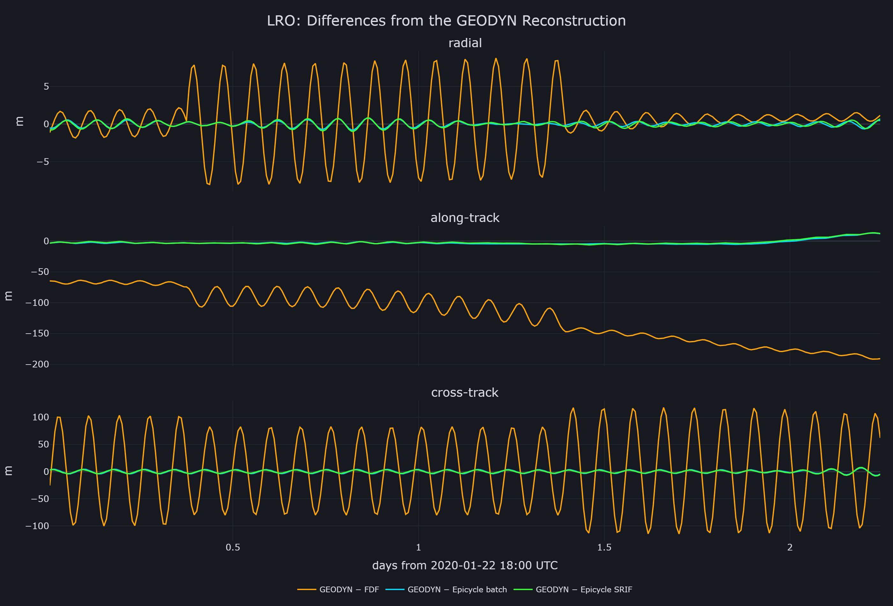

# Juno Small-Force Estimation

A Juno OD solution estimates small forces as events. The solution processes a month of Juno's 2014 cruise from DSN ramped Doppler and sequential range, during which the spacecraft made eleven attitude slews, each leaving a small ΔV. Each slew enters the fit as an impulsive maneuver, the same event used to model a maneuver when designing a trajectory. The fit uses the planets and the Moon as point masses, cannonball solar radiation pressure, the DSN troposphere and ionosphere calibrations, and the spacecraft's spin in the Doppler model. It estimates 47 parameters: the state, the reflectivity, seven range biases and all three ΔV components of every slew, 33 in all. Residuals are 1.0 mHz Doppler and 0.23 m range RMS.

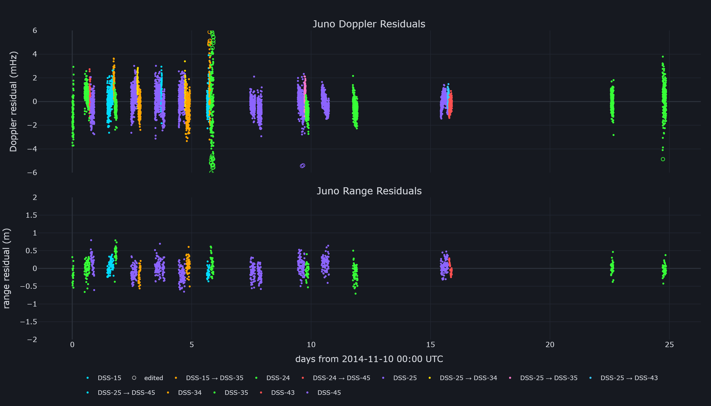

# LAGEOS Precision OD

A LAGEOS OD solution agrees with DGFI and the ILRS as closely as they agree with each other (millimeters radial, centimeters along-track and cross-track). The solution processes a week of LAGEOS-1 SLR data from twenty-one ILRS stations. The fit uses sub-daily Earth orientation, solid-tide, pole-tide and ocean-loading station displacements, the Mendes-Pavlis troposphere, a 60 × 60 field with solid and ocean tides, cannonball solar radiation pressure, and relativity. It estimates 46 parameters: the state, the reflectivity, 18 empirical accelerations and a range bias for every station. Epicycle's solution differs from DGFI's by 4.3 mm radial, 1.3 cm along-track and 3.3 cm cross-track RMS, and from the ILRS combined solution by 4.8 mm, 2.6 cm and 1.7 cm; the two published orbits differ from each other by 3.7 mm, 2.0 cm and 3.3 cm.

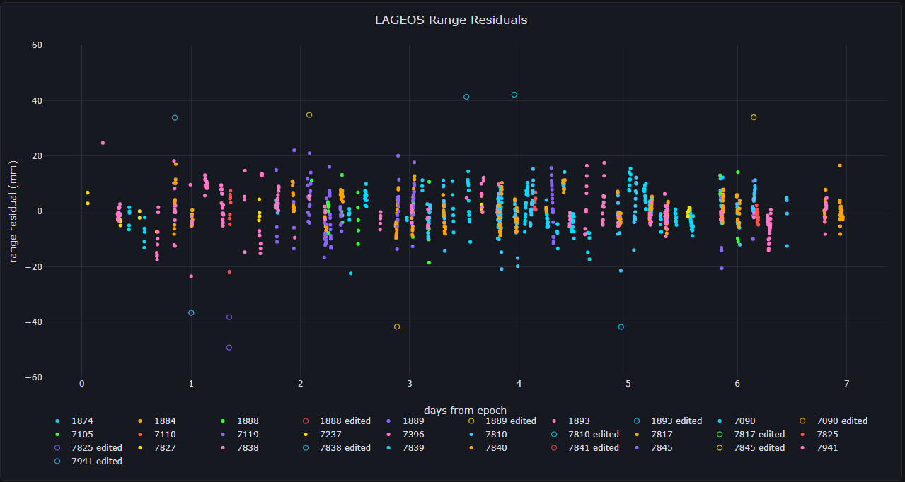

# MESSENGER OD with ΔDOR

A MESSENGER OD solution agrees with the navigation team's od431 reconstruction to a few kilometers, and ΔDOR resolves the plane of the sky. The solution processes thirty-five days of MESSENGER's approach to Mercury in 2011, from DSN ramped Doppler, sequential range and ΔDOR against ICRF3 quasars. The fit uses the planets and the Moon as point masses, solar relativity, plate solar radiation pressure on an eight-plate sunshade and both sides of the solar panels oriented by the reconstructed attitude, Moyer's corona model in every leg of the light time, and the DSN troposphere and ionosphere calibrations. It estimates 39 parameters: the state, six plate-group scale factors, the sunshade reflectivities, the corona strength, ten range biases and fourteen three-way Doppler biases. The batch estimator and the epoch-state square-root information filter reach the same solution. Epicycle's solution differs from od431 by 1.0 km radial, 2.1 km along-track and 1.2 km cross-track RMS, and by 13 nrad on the plane of the sky; without ΔDOR the difference reaches 21 km.

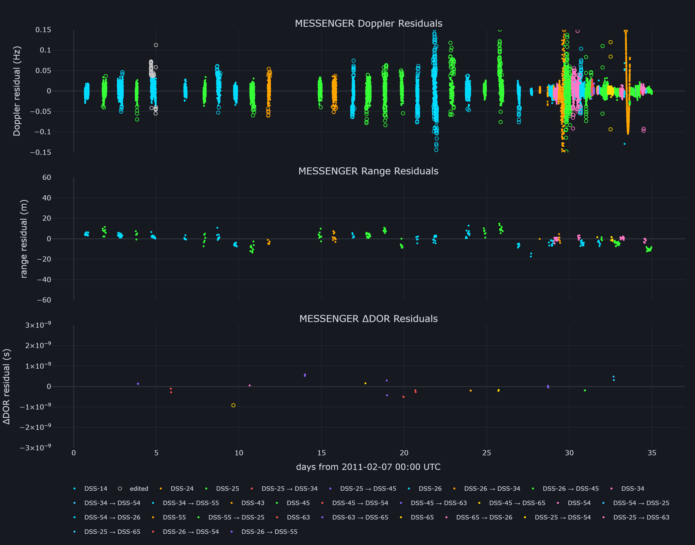

# GEO Transfer

A bi-elliptic transfer from a low inclined orbit to geosynchronous orbit with three impulsive burns: transfer orbit insertion, a mid-course correction at an 85,000 km apogee that removes the inclination, and orbit insertion at 42,166 km. The burns and five coast segments form one event sequence, a directed acyclic graph, and IPOPT solves for the burn components that meet the apogee, inclination and final semi-major axis constraints.

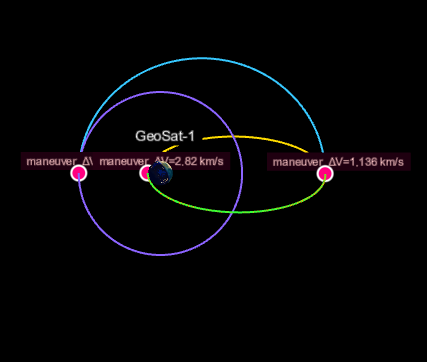

# Safety Ellipse Transfer

A transfer from a 200 m passive safety ellipse to a 50 m inspection ellipse about a chief at ISS altitude, in Clohessy-Wiltshire dynamics with a per-axis acceleration limit. The arrival is a manifold rather than a point: any phase on the target ellipse is acceptable. The minimum-energy solution is computed with Legendre-Gauss-Lobatto collocation, 15 intervals of 5 nodes, solved with IPOPT. The arrows are the thrust direction.

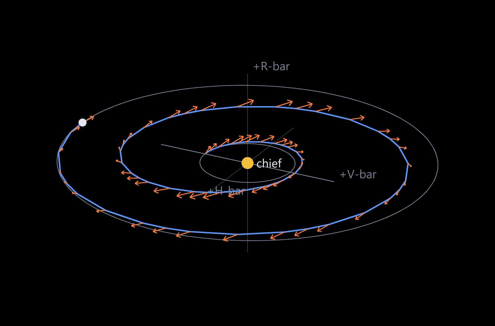

# Low-Thrust Orbit Raising

Bryson's orbit raising problem: a constant-thrust spacecraft steers to reach the largest circular orbit in a fixed time. Hermite-Simpson collocation with 40 steps and analytic partials, solved with IPOPT from a tangential-thrust initial guess, reaches a final radius of 1.523, matching the CSALT reference.

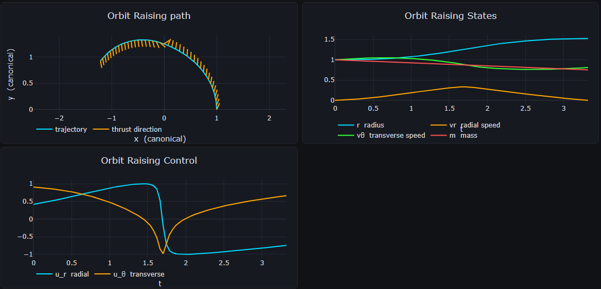

# Hybrid Transcription

Low-thrust orbit raising with three phases, each with a different transcription — zero-order hold, Hermite-Simpson and
Legendre-Gauss-Lobatto.

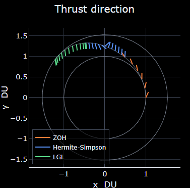

# Goddard Rocket

The Goddard rocket problem: maximize the peak altitude of a vertical rocket with altitude-dependent drag. The solution has three phases with free switch times: full thrust, a singular arc held by Betts's singular-arc path constraint, and a coast. Each phase is Hermite-Simpson collocation, and IPOPT solves them together with continuity links.

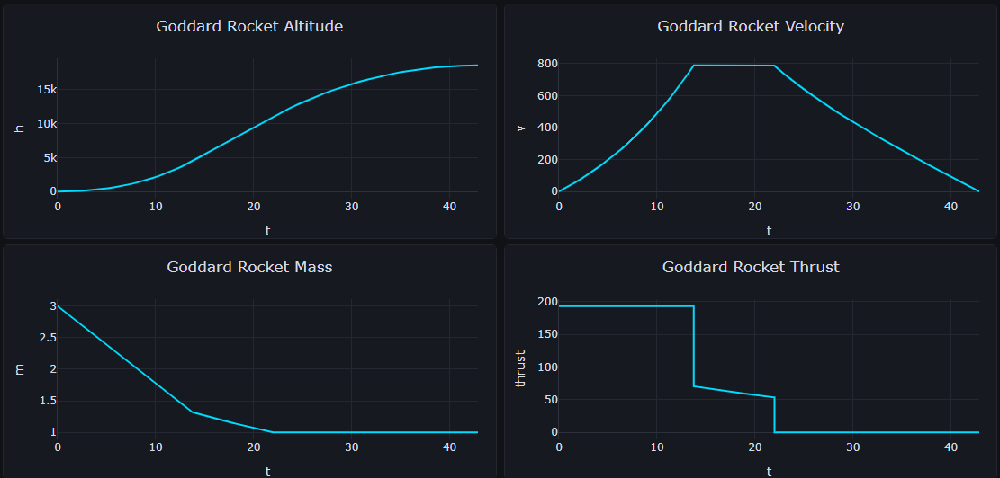

# Linear Tangent Steering

The linear tangent steering problem: a vehicle with constant acceleration steers to reach a given altitude and horizontal velocity, with zero vertical velocity, in minimum time. Hermite-Simpson collocation with 60 steps and a free final time gives 0.5546 s, matching the analytic linear tangent law and Bryson and Ho.

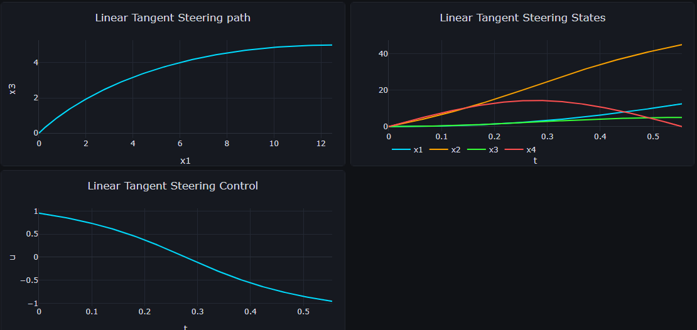

# Obstacle Avoidance

A constant-speed vehicle steers by heading between two points while avoiding two circular keep-out zones. The cost is fixed by the speed, so the clearance path constraints, enforced at every mesh point, decide the route. Solved with Hermite-Simpson collocation and IPOPT.

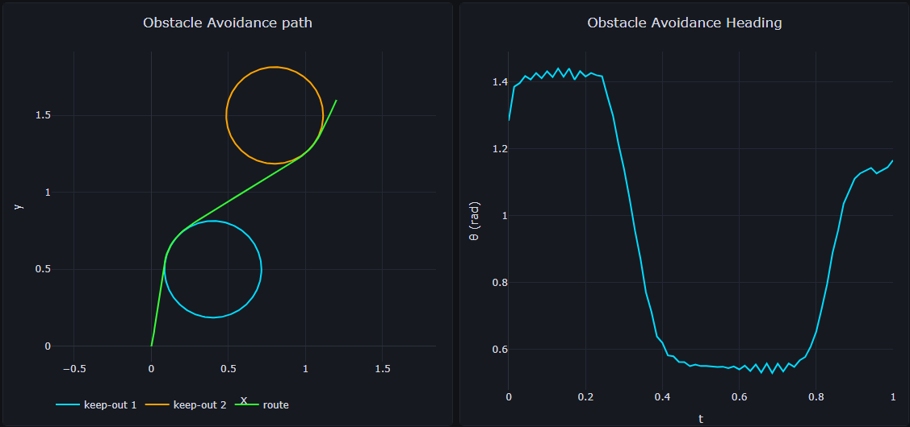

# Lyapunov Orbit Transfer

A transfer from an L1 to an L2 Lyapunov orbit of equal energy in the Earth-Moon circular restricted three-body problem, both orbits from JPL's periodic orbit catalog. The cost is the integrated squared control with a free transfer time; it approaches zero because a ballistic heteroclinic connection exists between the two orbits. Solved with Hermite-Simpson collocation and IPOPT.

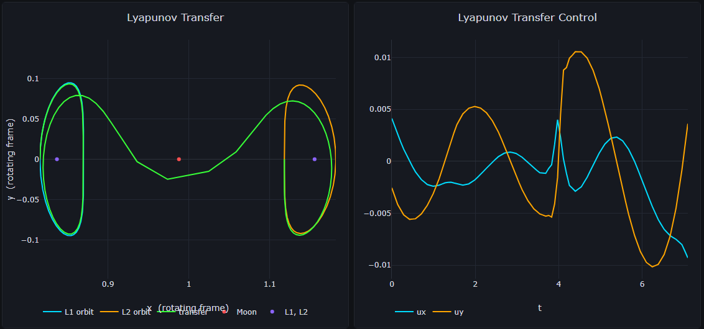

# Apophis Rendezvous

A 360-day low-thrust rendezvous from Earth to the asteroid Apophis for a 1500 kg spacecraft with a 1 N, 3000 s thruster, minimizing propellant. The Sims-Flanagan transcription splits the trajectory into 40 segments, half propagated forward from Earth and half backward from Apophis, meeting at a match point, and IPOPT solves for the throttles.

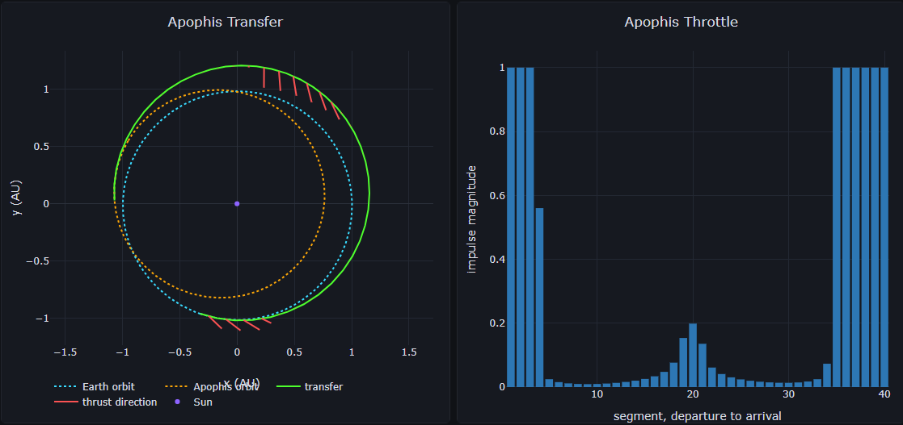

# Gravity Assist

An Earth-Earth-Venus trajectory that maximizes the mass delivered into a Venus parking orbit, with a launch vehicle mass model, a C3 limit and a minimum flyby altitude. Each leg is a patched-conic arc with one deep-space maneuver, and IPOPT solves for the epochs, v∞ and maneuvers. The solution delivers 91.6 kg after 512 days.


# Cassini Global Search

`GlobalSearch` finds the flyby sequence and the trajectory together. When the sequences are few
enough to list, it first surveys every one with random starts and basin hops, then a genetic
algorithm evolves the population; each candidate is solved as a nonlinear program, and only
transfers that pass a realism check are kept. A search writes its progress to its folder, so it can
be stopped and resumed.

Cassini, with the flyby sequence left to the search: Earth to Saturn, up to four flybys of Venus,
Earth, Mars and Jupiter, a launch in 1997 or early 1998 at Cassini's launch energy, eight years of
flight at most, and insertion into a 1.3 × 150 Saturn-radii orbit. The cost is the total ΔV after
launch. The best of the 341 sequences is the one Cassini flew, Venus, Venus, Earth, Jupiter, at
0.854 km/s, launching ten days after Cassini did.

```julia
using Epicycle

R_S = 60268.0
cassini = ImpulsiveMission(departure = earth, target = saturn,
                           flyby_bodies = [venus, earth, mars, jupiter], max_flybys = 4,
                           launch_window = ("1997-01-01", "1998-06-30"),
                           max_flight_time = 2922.0, max_launch_vinf = 4.1,
                           arrival = OrbitInsertion(periapsis = 1.3R_S, apoapsis = 150R_S, Isp = 320.0))
search = GlobalSearch(cassini; folder = "cassini", population = 150, generations = 20, workers = 5)
evolve!(search)
```

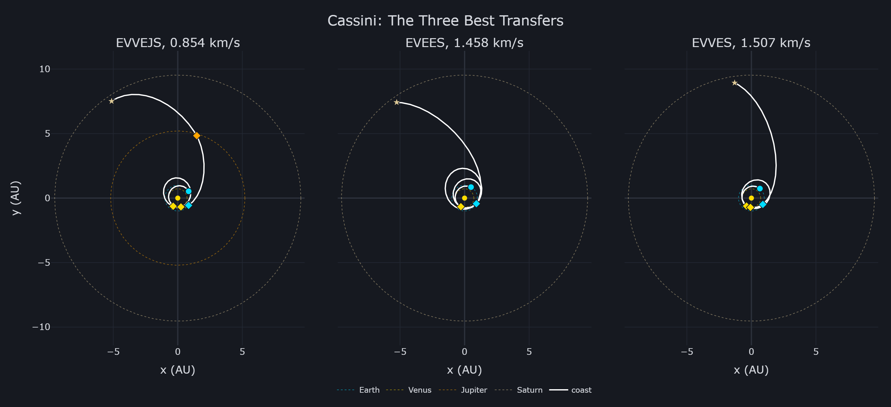

# Europa Clipper Global Search

Europa Clipper, in its 2024 launch period at its launch requirement of C3 up to 41.69 km²/s², six
years of flight at most, and insertion into an 11 × 265 Jupiter-radii orbit. The sequence Clipper
flew, Mars then Earth, comes second at 1.309 km/s, 10 m/s behind a Mars, Venus, Earth tour. It
launches on 17 October 2024 and flies Mars on 1 March 2025, the day Clipper did.

```julia
using Epicycle

R_J = 71492.0
clipper = ImpulsiveMission(departure = earth, target = jupiter,
                           flyby_bodies = [venus, earth, mars], max_flybys = 4,
                           launch_window = ("2024-10-01", "2024-11-15"),
                           max_flight_time = 2192.0, max_launch_vinf = sqrt(41.69),
                           arrival = OrbitInsertion(periapsis = 11R_J, apoapsis = 265R_J, Isp = 320.0))
search = GlobalSearch(clipper; folder = "clipper", population = 150, generations = 20, workers = 5)
evolve!(search)
```

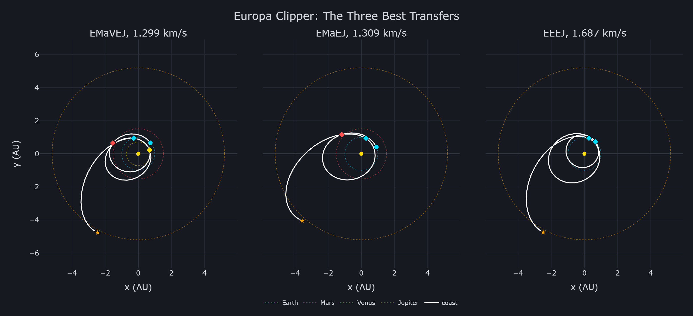

# Low-Thrust Global Search to Jupiter

Solar-electric transfers to Jupiter and Saturn, launched on a Falcon 9 between 2030 and 2040, with
ten years of flight at most and up to four flybys. The launch mass follows the launch C3 on the
Falcon 9 performance curve, and two NEXT-class thrusters give 0.47 N at 4100 s with full power at
1 AU, falling as 1/r² beyond. Each leg is a Sims-Flanagan transcription, and the cost is the mass
delivered after a chemical orbit insertion. Each search surveyed every sequence before the genetic
algorithm ran, and each of the best transfers was then solved again with every segment under 5 %
throttle held at zero, so the coasts carry no residual thrust. The best to Jupiter launches 3280 kg
on an Earth, Mars, Mars, Mars tour, burns 316 kg of propellant and delivers 2394 kg; the best to
Saturn launches 3280 kg through Earth twice and Jupiter, burns 259 kg and delivers 2736 kg. Thrust
arcs are orange, with the thrust direction in red.

```julia
using Epicycle

falcon9 = LaunchVehicle(name = "Falcon 9 (ASDS)",
                        coefficients = [3310.0, -105.4538, -2.663866, 0.2309244], max_c3 = 10.0)
spacecraft = LowThrustSpacecraft(Isp = 4100.0, thrust = 0.47, power = SolarPower())

R_J = 71492.0
to_jupiter = LowThrustMission(departure = earth, target = jupiter,
                              flyby_bodies = [venus, earth, mars], max_flybys = 4,
                              launch_window = ("2030-01-01", "2040-01-01"), max_flight_time = 3652.5,
                              spacecraft = spacecraft, launch_vehicle = falcon9,
                              arrival = OrbitInsertion(periapsis = 4R_J, apoapsis = 150R_J, Isp = 320.0))
search = GlobalSearch(to_jupiter; folder = "jupiter", population = 150, generations = 100, workers = 5)
evolve!(search)
```

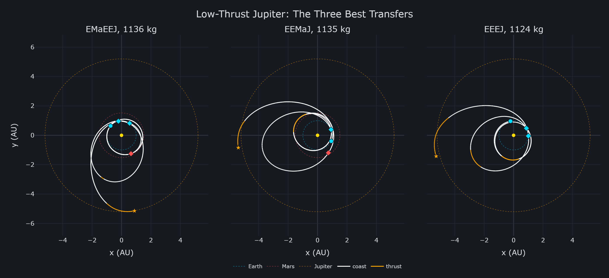

# Low-Thrust Global Search to Saturn

The Saturn search is the same with Jupiter among the flyby bodies, no closer than 3 Jupiter radii,
and insertion into a 1.3 × 150 Saturn-radii orbit.

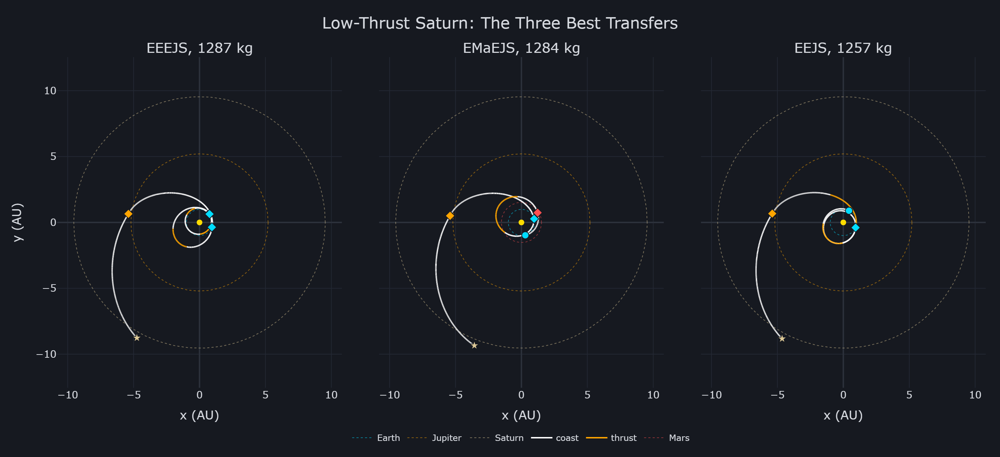

# Halo Orbit Manifolds

A preview of work in progress; this example is not yet in `Epicycle/examples/`.

A Sun-Earth L2 halo orbit with an out-of-plane amplitude of about 200,000 km, started from JPL's
three-body periodic orbit catalog, with its stable manifold in the circular restricted three-body
problem. The red trajectories are the transfers from near Earth with the lowest perigee.

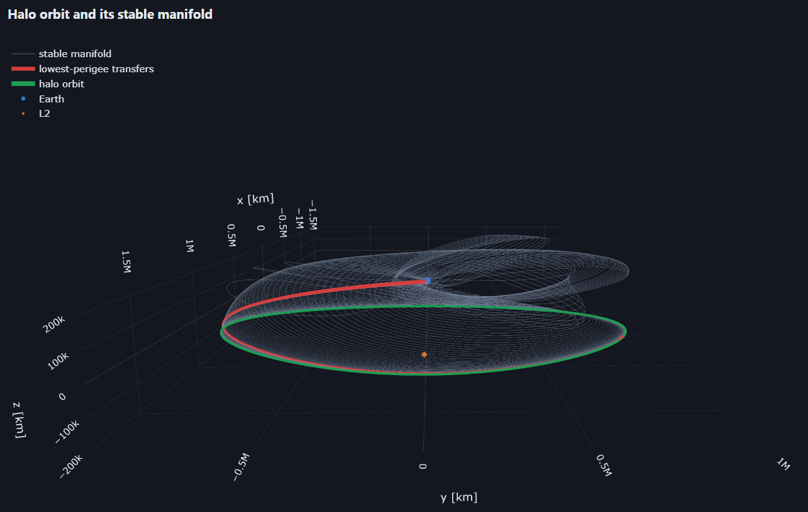

# Halo Orbit Family

The Sun-Earth L2 northern halo family, continued from that orbit with BifurcationKit.jl.

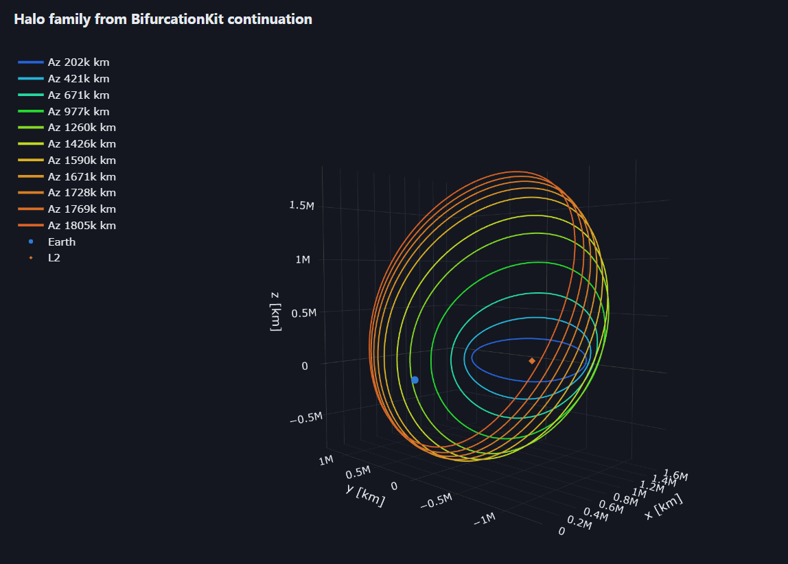

# Stepped Kalman Filter

Stepping the filter one observation at a time, with the postfit residuals and the formal sigma
recorded at each update.

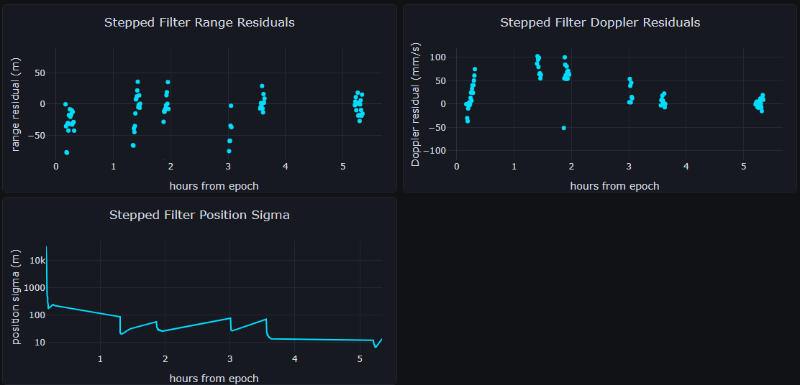

# Plotting

A gallery of supported data visualization styles.

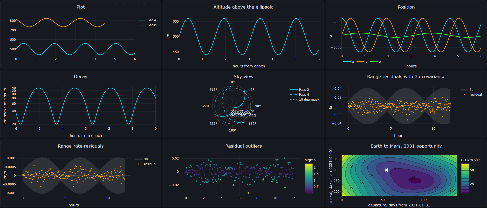

# A Trajectory on the Globe

A view of Earth and an orbit.

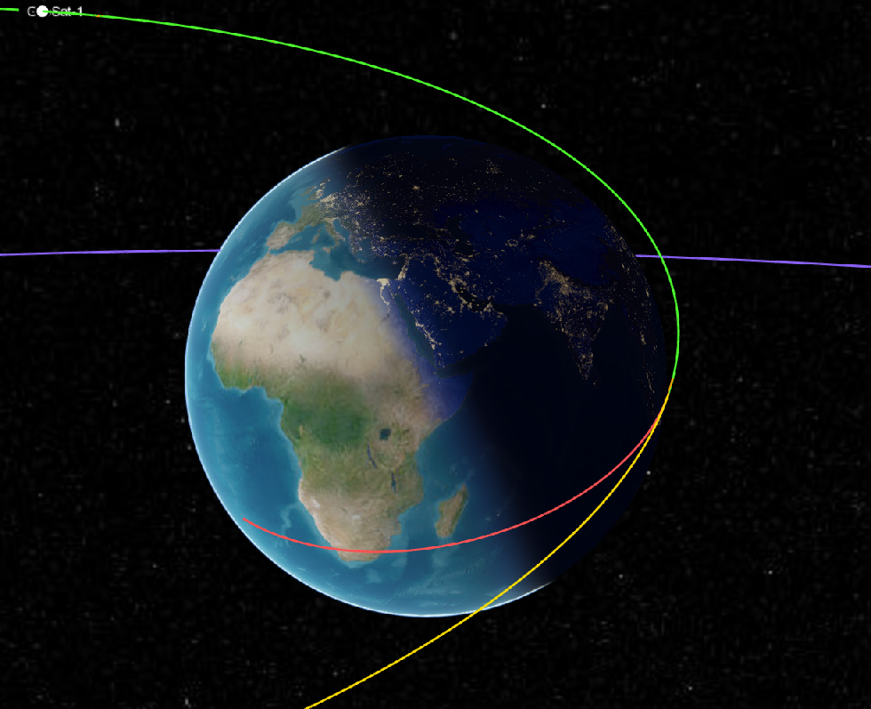

# Working in the Editor

This is `Ex_HohmannTransfer.jl` open in VS Code with the solver report in the terminal.

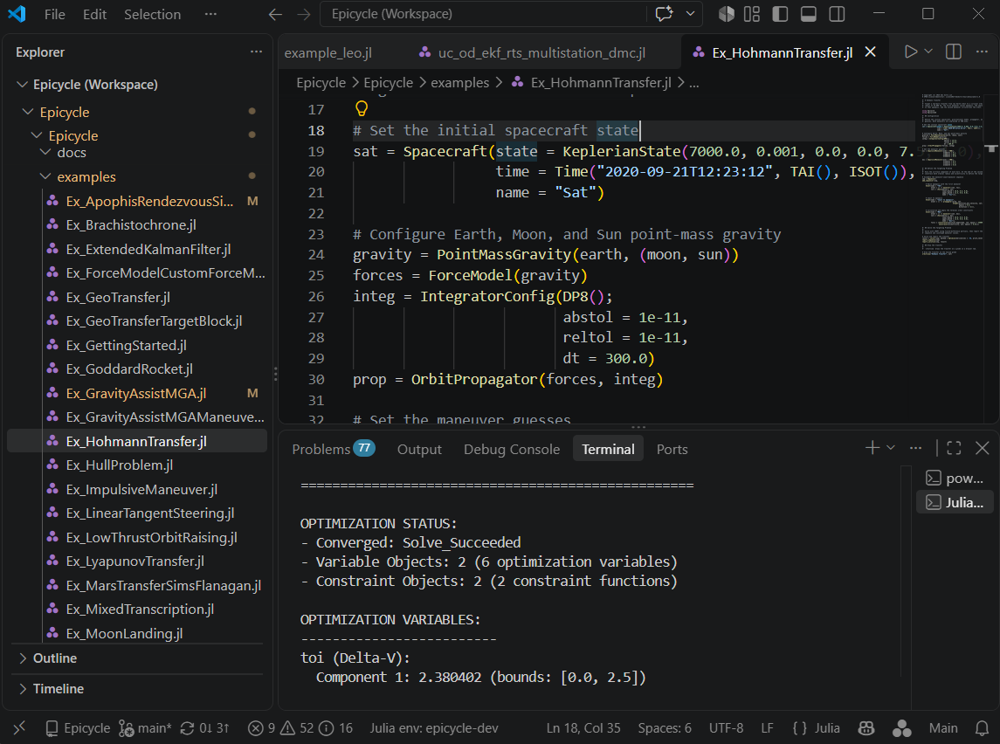
