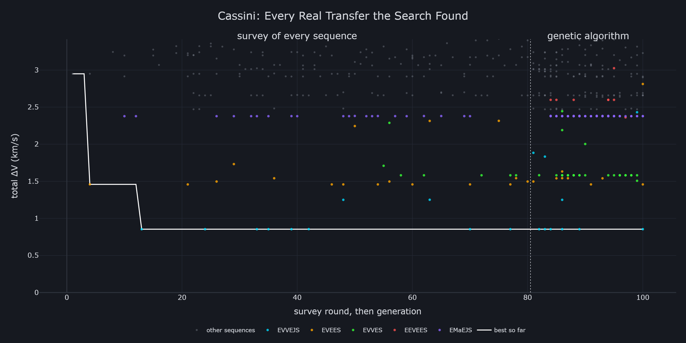
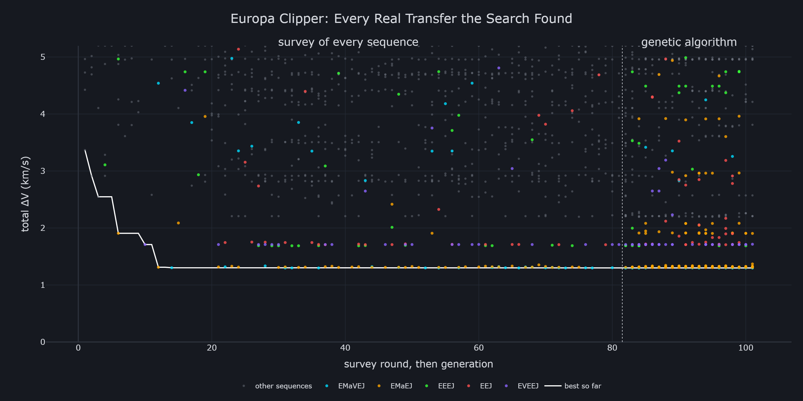
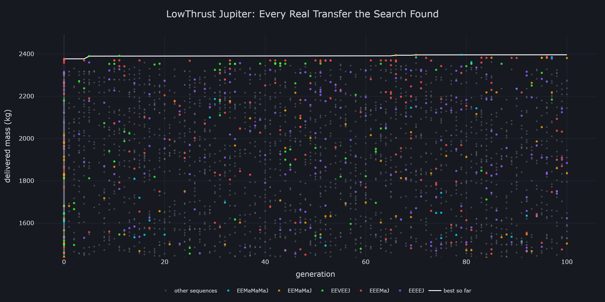
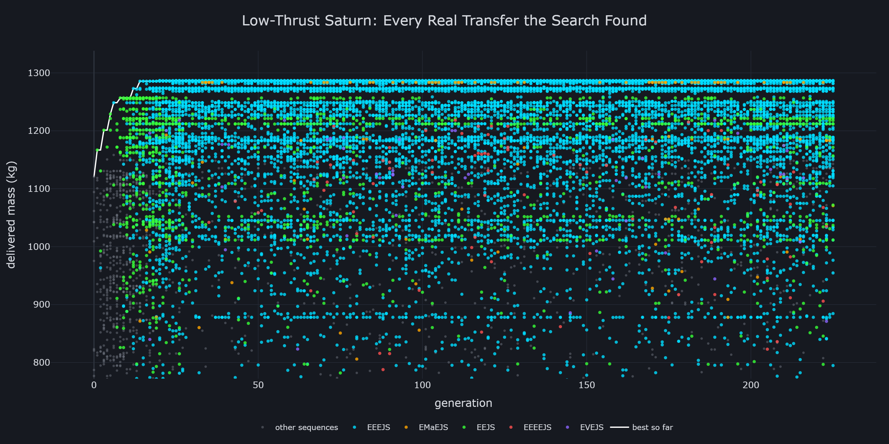

# Gallery

Output from the example scripts that ship in `Epicycle/examples/` and from work in development.

## A Trajectory on the Globe

A view of Earth and an orbit.


## Working in the Editor

This is `Ex_HohmannTransfer.jl` open in VS Code with the solver report in the terminal.


## OD Solutions from Real Tracking Data

Two days of the Lunar Reconnaissance Orbiter from the S-band Doppler and range of the NASA ground
network, differenced with the LOLA team's GEODYN reconstruction and the Flight Dynamics Facility's
daily reconstruction in the radial, along-track and cross-track axes. Against GEODYN the RMS
difference is 0.3 m radial, 4.4 m along-track and 2.8 m cross-track.


A month of Juno's 2014 cruise from DSN two-way and three-way Doppler and sequential range, with
the uplink ramps, the DSN's troposphere and ionosphere calibrations and the spacecraft's spin in the
measurement models. Eleven attitude slews from the small-forces file enter the fit as impulsive
maneuvers, the same events used in mission design, and their ΔV is estimated. Post-fit residuals of
1.0 mHz and 0.23 m.


The same fit differenced with JPL's reconstruction, with the slews estimated, held at the file's
values and left out. Estimating them brings the RMS difference to 1.4 km radial, 7.1 km along-track
and 20 km cross-track.


A week of LAGEOS-1 laser ranging from the ILRS normal points, with the IERS station displacements,
sub-daily Earth orientation and the Mendes-Pavlis troposphere. Post-fit residuals of 6.5 mm over
twenty-one stations; the hollow points are the normal points the editing left out.


Thirty-five days of MESSENGER's approach to Mercury in 2011 from DSN Doppler, range and ΔDOR, with
an eight-plate sunshade and solar panels oriented by the reconstructed attitude, and Moyer's solar
corona model. Post-fit residuals in Hz, meters and seconds.


The same fit differenced with the navigation team's od431 reconstruction: 1.0 km radial, 2.1 km
along-track, 1.2 km cross-track and 13 nrad on the plane of the sky. Without ΔDOR the cross-track
difference grows to 13.5 km.


## Propagation and Targeting

A Hohmann transfer between two circular orbits.


A geosynchronous orbit transfer.


A close-proximity transfer onto a safety ellipse, in the chief's rotating frame. The arrows are
the thrust direction.


## Optimal Control

Low-thrust orbit raising.


Low-thrust orbit raising with three phases, each with a different transcription — zero-order hold, Hermite-Simpson and
Legendre-Gauss-Lobatto.


The Goddard rocket problem.


The linear tangent steering problem.


A minimum-time route between two keep-out zones, where the clearance is a path constraint.


A transfer between L1 and L2 Lyapunov orbits.


## Interplanetary

An Earth to Apophis rendezvous with Sims-Flanagan transcription.


An Earth-Earth-Venus gravity assist.


## Global Search for Interplanetary Transfers

`GlobalSearch` finds the flyby sequence and the trajectory together. When the sequences are few
enough to list, it first surveys every one with random starts and basin hops, then a genetic
algorithm evolves the population; each candidate is solved as a nonlinear program, and only
transfers that pass a realism check are kept. A search writes its progress to its folder, so it can
be stopped and resumed.

Cassini, with the flyby sequence left to the search: Earth to Saturn, up to four flybys of Venus,
Earth, Mars and Jupiter, a launch in 1997 or early 1998 at Cassini's launch energy, eight years of
flight at most, and insertion into a 1.3 × 150 Saturn-radii orbit. The cost is the total ΔV after
launch. The best of the 341 sequences is the one Cassini flew, Venus, Venus, Earth, Jupiter, at
0.854 km/s, launching ten days after Cassini did.

```julia
using Epicycle

R_S = 60268.0
cassini = ImpulsiveMission(departure = earth, target = saturn,
                           flyby_bodies = [venus, earth, mars, jupiter], max_flybys = 4,
                           launch_window = ("1997-01-01", "1998-06-30"),
                           max_flight_time = 2922.0, max_launch_vinf = 4.1,
                           arrival = OrbitInsertion(periapsis = 1.3R_S, apoapsis = 150R_S, Isp = 320.0))
search = GlobalSearch(cassini; folder = "cassini", population = 150, generations = 20, workers = 5)
evolve!(search)
```




Europa Clipper, in its 2024 launch period at its launch requirement of C3 up to 41.69 km²/s², six
years of flight at most, and insertion into an 11 × 265 Jupiter-radii orbit. The sequence Clipper
flew, Mars then Earth, comes second at 1.309 km/s, 10 m/s behind a Mars, Venus, Earth tour. It
launches on 17 October 2024 and flies Mars on 1 March 2025, the day Clipper did.

```julia
using Epicycle

R_J = 71492.0
clipper = ImpulsiveMission(departure = earth, target = jupiter,
                           flyby_bodies = [venus, earth, mars], max_flybys = 4,
                           launch_window = ("2024-10-01", "2024-11-15"),
                           max_flight_time = 2192.0, max_launch_vinf = sqrt(41.69),
                           arrival = OrbitInsertion(periapsis = 11R_J, apoapsis = 265R_J, Isp = 320.0))
search = GlobalSearch(clipper; folder = "clipper", population = 150, generations = 20, workers = 5)
evolve!(search)
```




Low-thrust transfers to Jupiter and Saturn for a 1500 kg spacecraft with a 0.1 N, 3000 s electric
thruster, launching between 2030 and 2040 at up to 4 km/s, ten years of flight at most, and up to
four flybys. Each leg is a Sims-Flanagan transcription, and the cost is the mass delivered after a
chemical orbit insertion. These searches ran before the survey was added, so they are the genetic
algorithm alone. Each of the three best was then solved again with every segment under 5 % throttle held at zero, so the coasts carry no residual thrust. The best to Jupiter delivers 1134 kg on a Mars, Earth, Earth tour; the best to Saturn delivers
1284 kg through Earth twice and Jupiter. Thrust arcs are orange.

```julia
using Epicycle

R_J = 71492.0
spacecraft = LowThrustSpacecraft(mass = 1500.0, Isp = 3000.0, thrust = 0.1)
to_jupiter = LowThrustMission(departure = earth, target = jupiter,
                              flyby_bodies = [venus, earth, mars], max_flybys = 4,
                              launch_window = ("2030-01-01", "2040-01-01"),
                              max_flight_time = 3652.5, max_launch_vinf = 4.0, spacecraft = spacecraft,
                              arrival = OrbitInsertion(periapsis = 4R_J, apoapsis = 150R_J, Isp = 320.0))
search = GlobalSearch(to_jupiter; folder = "jupiter", population = 150, generations = 300, workers = 5)
evolve!(search)
```




The Saturn search is the same with Jupiter among the flyby bodies, no closer than 3 Jupiter radii,
and insertion into a 1.3 × 150 Saturn-radii orbit.




## Dynamical Systems

A preview of work in progress; this example is not yet in `Epicycle/examples/`.

A Sun-Earth L2 halo orbit with an out-of-plane amplitude of about 200,000 km, started from JPL's
three-body periodic orbit catalog, with its stable manifold in the circular restricted three-body
problem. The red trajectories are the transfers from near Earth with the lowest perigee.


The Sun-Earth L2 northern halo family, continued from that orbit with BifurcationKit.jl.


## Orbit Determination

A batch least-squares fit to six hours of range and Doppler tracking from two ground stations.


A filter set up to process measurements as they arrive.


A filter-smoother solution.


Stepping the filter one observation at a time, with the postfit residuals and the formal sigma
recorded at each update.


## Plotting

A gallery of supported data visualization styles.


