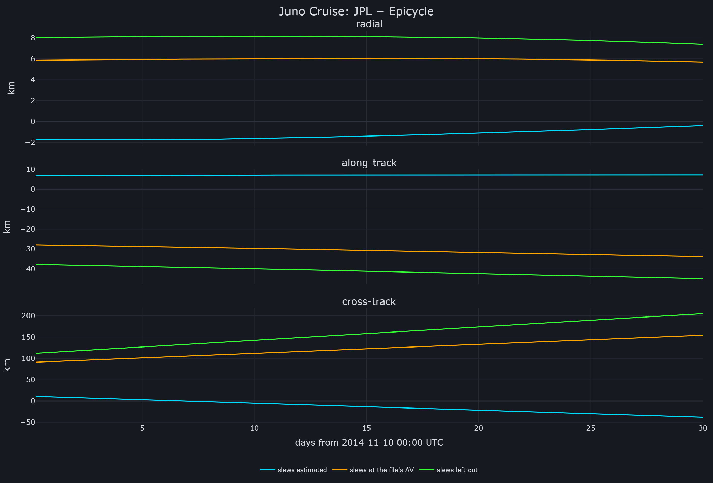
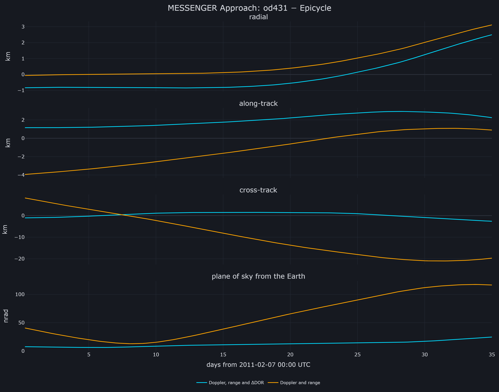
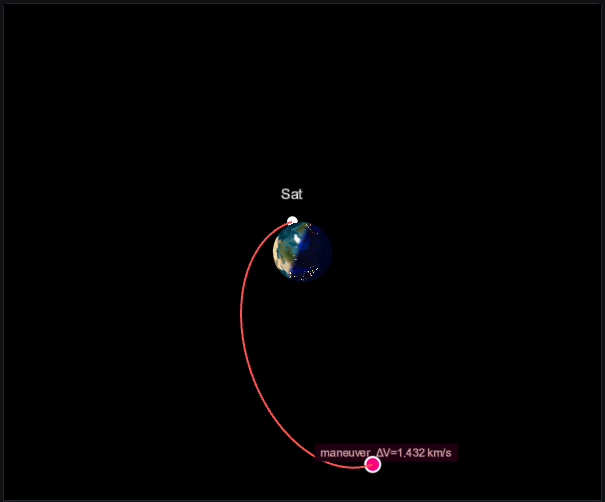
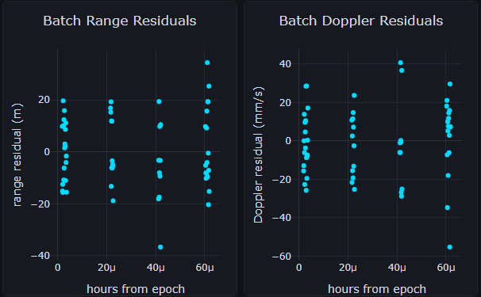
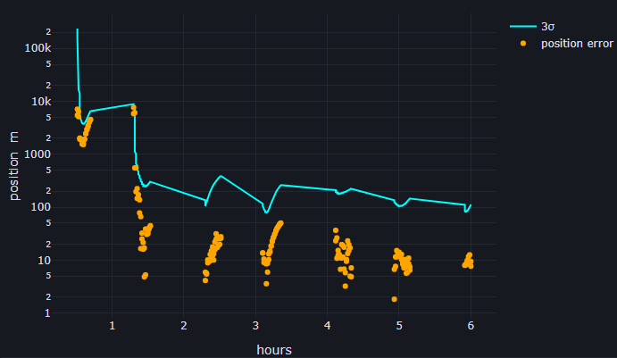
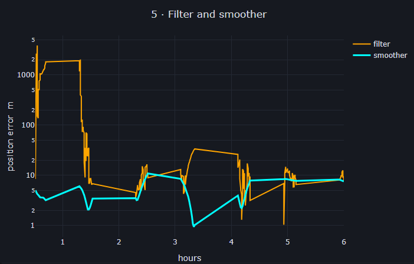

# Gallery

Output from the example scripts that ship in `Epicycle/examples/` and from work in development.

## A Trajectory on the Globe

A view of Earth and an orbit.

## Working in the Editor

This is `Ex_HohmannTransfer.jl` open in VS Code with the solver report in the terminal.

## OD Solutions from Real Tracking Data

Two days of the Lunar Reconnaissance Orbiter from the S-band Doppler and range of the NASA ground
network, differenced with the LOLA team's GEODYN reconstruction and the Flight Dynamics Facility's
daily reconstruction in the radial, along-track and cross-track axes. Against GEODYN the RMS
difference is 0.3 m radial, 4.4 m along-track and 2.8 m cross-track.

A month of Juno's 2014 cruise from DSN two-way and three-way Doppler and sequential range, with
the uplink ramps, the DSN's troposphere and ionosphere calibrations and the spacecraft's spin in the
measurement models. Eleven attitude slews from the small-forces file enter the fit as impulsive
maneuvers, the same events used in mission design, and their ΔV is estimated. Post-fit residuals of
1.0 mHz and 0.23 m.

The same fit differenced with JPL's reconstruction, with the slews estimated, held at the file's
values and left out. Estimating them brings the RMS difference to 1.4 km radial, 7.1 km along-track
and 20 km cross-track.

A week of LAGEOS-1 laser ranging from the ILRS normal points, with the IERS station displacements,
sub-daily Earth orientation and the Mendes-Pavlis troposphere. Post-fit residuals of 6.5 mm over
twenty-one stations; the hollow points are the normal points the editing left out.

Thirty-five days of MESSENGER's approach to Mercury in 2011 from DSN Doppler, range and ΔDOR, with
an eight-plate sunshade and solar panels oriented by the reconstructed attitude, and Moyer's solar
corona model. Post-fit residuals in Hz, meters and seconds.

The same fit differenced with the navigation team's od431 reconstruction: 1.0 km radial, 2.1 km
along-track, 1.2 km cross-track and 13 nrad on the plane of the sky. Without ΔDOR the cross-track
difference grows to 13.5 km.

## Propagation and Targeting

A Hohmann transfer between two circular orbits.

A geosynchronous orbit transfer.

A close-proximity transfer onto a safety ellipse, in the chief's rotating frame. The arrows are
the thrust direction.

## Optimal Control

Low-thrust orbit raising.

Low-thrust orbit raising with three phases, each with a different transcription — zero-order hold, Hermite-Simpson and
Legendre-Gauss-Lobatto.

The Goddard rocket problem.

The linear tangent steering problem.

A minimum-time route between two keep-out zones, where the clearance is a path constraint.

A transfer between L1 and L2 Lyapunov orbits.

## Interplanetary

An Earth to Apophis rendezvous with Sims-Flanagan transcription.

An Earth-Earth-Venus gravity assist.

## Dynamical Systems

A preview of work in progress; this example is not yet in `Epicycle/examples/`.

A Sun-Earth L2 halo orbit with an out-of-plane amplitude of about 200,000 km, started from JPL's
three-body periodic orbit catalog, with its stable manifold in the circular restricted three-body
problem. The red trajectories are the transfers from near Earth with the lowest perigee.

The Sun-Earth L2 northern halo family, continued from that orbit with BifurcationKit.jl.

## Orbit Determination

A batch least-squares fit to six hours of range and Doppler tracking from two ground stations.

A filter set up to process measurements as they arrive.

A filter-smoother solution.

Stepping the filter one observation at a time, with the postfit residuals and the formal sigma
recorded at each update.

## Plotting

A gallery of supported data visualization styles.

