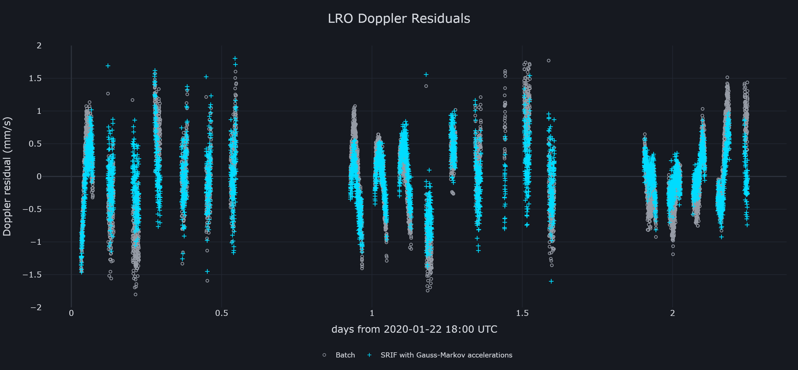

# Gallery

This gallery shows Epicycle applied to real-world, hard problems. The examples include precision OD applied to Earth, lunar, and interplanetary trajectories, global trajectory optimization without a priori knowledge of the solution, dynamical systems theory generating periodic orbits and stable and unstable manifolds, and hybrid optimal control employing collocation and shooting methods in a single problem configuration. Some entries come from the example scripts in `Epicycle/examples/`; the rest are work in development. Precision OD and global optimization are work in progress to be included in an upcoming production release.

# LRO Precision OD

An LRO OD solution agrees with the LOLA science team's orbit to meters. The solution processes two days of LRO S-band Doppler and range from three NASA ground network stations. The fit uses the GRGM900C lunar field to degree 150 with lunar solid tides raised by the Earth and Sun, Earth, Sun and Jupiter point masses, cannonball solar radiation pressure, relativity, the Saastamoinen troposphere with reported weather, and the JPL global ionosphere maps. It estimates 17 parameters: the state, the reflectivity, an along-track acceleration, and Doppler, range and range time-tag biases for each station. The same data are also fit with the epoch-state square-root information filter and smoother, which adds Gauss-Markov accelerations on each axis, each held for six hours: 27 more parameters. Epicycle's solution differs from the LOLA team's GEODYN reconstruction by 0.3 m radial, 4.4 m along-track and 2.8 m cross-track RMS with the batch estimator, and by 0.4 m, 4.4 m and 2.6 m with the filter and smoother. The Flight Dynamics Facility's daily solution differs from GEODYN by 3.9 m, 127 m and 70 m.


The filter's empirical accelerations, modeled as a first-order Gauss-Markov process, absorb the dynamics errors that leave each pass of Doppler residuals tilted in the batch fit, and the Doppler RMS falls from 0.63 to 0.44 mm/s.



# MESSENGER OD with ΔDOR

A MESSENGER OD solution agrees with the navigation team's od431 reconstruction to a few kilometers, and ΔDOR resolves the plane of the sky. The solution processes thirty-five days of MESSENGER's approach to Mercury in 2011, from DSN ramped Doppler, sequential range and ΔDOR against ICRF3 quasars. The fit uses the planets and the Moon as point masses, solar relativity, plate solar radiation pressure on an eight-plate sunshade and both sides of the solar panels oriented by the reconstructed attitude, Moyer's corona model in every leg of the light time, and the DSN troposphere and ionosphere calibrations. It estimates 39 parameters: the state, six plate-group scale factors, the sunshade reflectivities, the corona strength, ten range biases and fourteen three-way Doppler biases. The batch estimator and the epoch-state square-root information filter reach the same solution. Epicycle's solution differs from the navigation team's od431 reconstruction by 1.0 km radial, 2.1 km along-track and 1.2 km cross-track RMS, and by 13 nrad on the plane of the sky; without ΔDOR the difference reaches 21 km.


# Juno Small-Force Estimation

A Juno OD solution estimates small forces as events. The solution processes a month of Juno's 2014 cruise from DSN ramped Doppler and sequential range, during which the spacecraft made eleven attitude slews, each leaving a small ΔV. Each slew enters the fit as an impulsive maneuver, the same event used to model a maneuver when designing a trajectory. The fit uses the planets and the Moon as point masses, cannonball solar radiation pressure, the DSN troposphere and ionosphere calibrations, and the spacecraft's spin in the Doppler model. It estimates 47 parameters: the state, the reflectivity, seven range biases and all three ΔV components of every slew, 33 in all. Residuals are 1.0 mHz Doppler and 0.23 m range RMS.


# LAGEOS Precision OD

A LAGEOS OD solution agrees with DGFI and the ILRS as closely as they agree with each other (millimeters radial, centimeters along-track and cross-track). The solution processes a week of LAGEOS-1 SLR data from twenty-one ILRS stations. The fit uses sub-daily Earth orientation, solid-tide, pole-tide and ocean-loading station displacements, the Mendes-Pavlis troposphere, a 60 × 60 field with solid and ocean tides, cannonball solar radiation pressure, and relativity. It estimates 46 parameters: the state, the reflectivity, 18 empirical accelerations and a range bias for every station. Epicycle's solution differs from DGFI's by 4.3 mm radial, 1.3 cm along-track and 3.3 cm cross-track RMS, and from the ILRS combined solution by 4.8 mm, 2.6 cm and 1.7 cm; the two published orbits differ from each other by 3.7 mm, 2.0 cm and 3.3 cm.


# Propagation Accuracy and Speed

Epicycle's propagator is compared with GMAT R2026A and Orekit 13.1 on one day of low Earth orbit with a full force model: EGM96 70 × 70 gravity with solid tides, the Sun and Moon from DE440, drag, solar radiation pressure with Earth's shadow, and relativity. Each tool's high-accuracy reference run is compared with the others' to measure how well the force models agree, and each timed run is compared with its own tool's reference to measure its integration error.

| Reference runs after one day | Position difference | Velocity difference |
|:---|---:|---:|
| Epicycle and Orekit | 0.6 mm | 0.7 µm/s |
| Epicycle and GMAT | 11.0 cm | 99.5 µm/s |

The difference from GMAT comes from a convention for Earth's axes: Epicycle applies the IERS celestial-pole offsets and GMAT's Earth-fixed frame does not. With GMAT's convention the two agree to 2.3 cm.

| Fastest setting reaching a few millimeters | Setting | Position error | Time |
|:---|:---|---:|---:|
| Epicycle | Verner 7, 1e-11 | 0.2 mm | 0.25 s |
| GMAT | RungeKutta89, 1e-9 | 3.1 mm | 0.49 s |
| Orekit | Dormand-Prince 8(5,3), 1e-8 m | 8.0 mm | 1.20 s |

With matched methods and tolerances Epicycle's runs are 2.0 to 3.1 times shorter, and with the same 10 s fixed step about 2.2 times shorter. The full comparison, with the method and machine, is on the [Benchmarks](benchmarks.md) page, and the force models compared one at a time over five orbits are on the [Verification](verification.md) page.

# Time, Frames and States

Precision orbit determination depends on time scales, Earth orientation and coordinate frames being correct to well below the measurement noise. The OD solutions above worked on their first run because these models were verified first, each against a reference implementation.

| What | Checked against | Agreement |
|:---|:---|:---|
| Time scales and formats, 1,790 epochs in six scales | Astropy 8.0.1 (ERFA, the IAU's SOFA) | Bit identical |
| Earth frames, IAU 2006/2000A and FK5 chains | pyerfa (ERFA, the IAU's SOFA) | Under 2.5 µas |
| Body-fixed axes, the Sun and nine planets | SPICE `sxform` with `pck00011` | Under 10 µas |
| Lunar frames | SPICE `sxform` with the DE440 lunar kernels | Under 0.03 µas |

The details, with every known difference from each reference, are on the [Verification](verification.md) page.

# GEO Transfer

A bi-elliptic transfer from a low inclined orbit to geosynchronous orbit with three impulsive burns: transfer orbit insertion, a mid-course correction at an 85,000 km apogee that removes the inclination, and orbit insertion at 42,166 km. The burns and five coast segments form one event sequence, a directed acyclic graph, and IPOPT solves for the burn components that meet the apogee, inclination and final semi-major axis constraints.


# Safety Ellipse Transfer

A transfer from a 200 m passive safety ellipse to a 50 m inspection ellipse about a chief at ISS altitude, in Clohessy-Wiltshire dynamics with a per-axis acceleration limit. The arrival is a manifold rather than a point: any phase on the target ellipse is acceptable. The minimum-energy solution is computed with Legendre-Gauss-Lobatto collocation, 15 intervals of 5 nodes, solved with IPOPT. The arrows are the thrust direction.


# Low-Thrust Orbit Raising

Bryson's orbit raising problem: a constant-thrust spacecraft steers to reach the largest circular orbit in a fixed time. Hermite-Simpson collocation with 40 steps and analytic partials, solved with IPOPT from a tangential-thrust initial guess, reaches a final radius of 1.523, matching the CSALT reference.


# Hybrid Transcription

Bryson's orbit raising problem split into three phases, each with a different transcription: zero-order-hold multiple shooting, Hermite-Simpson collocation and Legendre-Gauss-Lobatto collocation. Links enforce state and time continuity at the phase boundaries, and one IPOPT problem solves the three together, reaching the 1.523 final radius of the single-phase solution.


# Goddard Rocket

The Goddard rocket problem: maximize the peak altitude of a vertical rocket with altitude-dependent drag. The solution has three phases with free switch times: full thrust, a singular arc held by Betts's singular-arc path constraint, and a coast. Each phase is Hermite-Simpson collocation, and IPOPT solves them together with continuity links.


# Linear Tangent Steering

The linear tangent steering problem: a vehicle with constant acceleration steers to reach a given altitude and horizontal velocity, with zero vertical velocity, in minimum time. Hermite-Simpson collocation with 60 steps and a free final time gives 0.5546 s, matching the analytic linear tangent law and Bryson and Ho.


# Obstacle Avoidance

A constant-speed vehicle steers by heading between two points while avoiding two circular keep-out zones. The cost is fixed by the speed, so the clearance path constraints, enforced at every mesh point, decide the route. Solved with Hermite-Simpson collocation and IPOPT.


# Lyapunov Orbit Transfer

A transfer from an L1 to an L2 Lyapunov orbit of equal energy in the Earth-Moon circular restricted three-body problem, both orbits from JPL's periodic orbit catalog. The cost is the integrated squared control with a free transfer time; it approaches zero because a ballistic heteroclinic connection exists between the two orbits. Solved with Hermite-Simpson collocation and IPOPT.


# Gravity Assist

An Earth-Earth-Venus trajectory, with circular coplanar planet orbits, that maximizes the mass delivered into a Venus parking orbit, with a launch vehicle mass model, a C3 limit and a minimum flyby altitude. Each leg is a patched-conic arc with one deep-space maneuver, and IPOPT solves for the epochs, v∞ and maneuvers. The solution delivers 91.6 kg after 512 days.


# Cassini Global Search

A global search finds the flyby sequence Cassini flew without an initial guess. The search covers Earth to Saturn with up to four flybys of Venus, Earth, Mars and Jupiter, 341 sequences in all, a launch between January 1997 and June 1998 at Cassini's launch energy, at most eight years of flight, and insertion into a 1.3 × 150 Saturn-radii orbit, minimizing the total ΔV after launch. It surveys every sequence with random starts and basin hops, then evolves the population with a genetic algorithm, solving each candidate as a nonlinear program and keeping only transfers that pass a realism check. The best transfer is Venus, Venus, Earth, Jupiter at 0.854 km/s, launching ten days after Cassini did.

```julia
using Epicycle

R_S = 60268.0
cassini = ImpulsiveMission(departure = earth, target = saturn,
                           flyby_bodies = [venus, earth, mars, jupiter], max_flybys = 4,
                           launch_window = ("1997-01-01", "1998-06-30"),
                           max_flight_time = 2922.0, max_launch_vinf = 4.1,
                           arrival = OrbitInsertion(periapsis = 1.3R_S, apoapsis = 150R_S, Isp = 320.0))
search = GlobalSearch(cassini; folder = "cassini", population = 150, generations = 20, workers = 5)
evolve!(search)
```


# Europa Clipper Global Search

A global search finds the flyby sequence Europa Clipper flew, and its Mars flyby date, without being given either. The search covers Clipper's 2024 launch period at its maximum launch C3 of 41.69 km²/s², with up to four flybys of Venus, Earth and Mars, at most six years of flight, and insertion into an 11 × 265 Jupiter-radii orbit. The sequence Clipper flew, Mars then Earth, comes second at 1.309 km/s, 10 m/s behind a Mars, Venus, Earth tour. It launches on 17 October 2024 and flies Mars on 1 March 2025, the day Clipper did.


# Low-Thrust Global Search to Jupiter

A low-thrust global search finds a solar-electric transfer to Jupiter that delivers 2394 kg from a Falcon 9 launch. The search covers launches between 2030 and 2040 with up to four flybys of Venus, Earth and Mars and at most ten years of flight. The launch mass follows the launch C3 on the Falcon 9 performance curve, and two NEXT-class thrusters give 0.47 N at 4100 s at 1 AU, falling as 1/r² farther out. Each leg is a Sims-Flanagan transcription, and the cost is the mass delivered after a chemical insertion into a 4 × 150 Jupiter-radii orbit. Each of the best transfers is then solved again with the segments under 5 % throttle held at zero, so the coasts carry no thrust. The best launches 3280 kg, flies Earth and then Mars three times, and burns 316 kg of propellant. Thrust arcs are orange, with the thrust direction in red.


# Low-Thrust Global Search to Saturn

A low-thrust global search to Saturn delivers 2736 kg. It is set up as the Jupiter search, with Jupiter added to the flyby bodies no closer than 3 Jupiter radii, and insertion into a 1.3 × 150 Saturn-radii orbit. The best transfer launches 3280 kg, flies Earth twice and then Jupiter, and burns 259 kg of propellant.


# Halo Orbit Manifolds

A Sun-Earth L2 halo orbit with an out-of-plane amplitude of about 200,000 km, started from JPL's three-body periodic orbit catalog, with its stable manifold in the circular restricted three-body problem. The red trajectories are the transfers from near Earth with the lowest perigee.


# Halo Orbit Family

The Sun-Earth L2 northern halo family, solved using continuation with BifurcationKit.jl.


# Stepped Kalman Filter

Stepping the filter one observation at a time, with the postfit residuals and the formal sigma recorded at each update.


# Plotting

A gallery of supported data visualization styles.


# A Trajectory on the Globe

A view of Earth and an orbit.


# Working in the Editor

This is `Ex_HohmannTransfer.jl` open in VS Code with the solver report in the terminal.


# Future Work

Future work will extend orbit determination to use machine learning to improve prediction accuracy, measured by definitive-to-predictive overlaps; to estimate gravity fields from tracking data; and to improve covariance realism in nonlinear filters, using Gaussian mixtures for non-Gaussian uncertainty with high-order derivatives computed to machine precision. We are investigating nonlinear programming for orbit determination, to see what large, sparse nonlinear solvers can bring to optimal estimation, and plan to implement closed-loop navigation and control, with the filter and the controller in one loop. For trajectory optimization, we plan to investigate machine learning for global search, and letting the genetic algorithm's outer loop choose the transcription as well as the flyby sequence.
